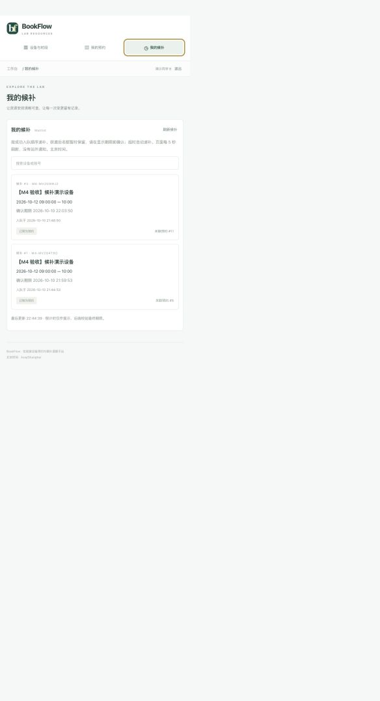
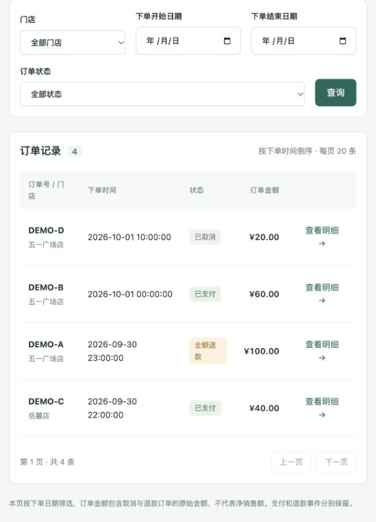

# Java 后端实习作品集

三个基于 Java 21、Spring Boot、MySQL 和 Vue 3 的学习项目，分别围绕预约并发、经营数据处理和知识库问答展开。仓库包含源码、数据库迁移、配置示例、测试和运行说明。

## 项目导航

| 项目 | 主要问题与实现 | 当前状态 |
| --- | --- | --- |
| [BookFlow · 设备预约与候补](bookflow/) | 事务、行锁和唯一约束控制时段占用；持久化幂等请求；限时确认与超时递补 | M1—M4 完成，主展示项目 |
| [门店订单与经营报表](order-reporting/) | CSV 整批事务导入、重复导入控制、门店数据权限、支付/退款事件报表、索引分析 | M1—M3 完成，报表浏览器交互仍待补验收 |
| [知页 · Java 知识库问答助手](java-knowledge-assistant/) | 文档切块、向量检索、引用校验、个人聊天隔离、文档版本管理 | M2 开发快照；默认 MOCK，真实模型效果未评测 |

推荐先看 **BookFlow**，再看**订单报表**。知识库助手作为进阶学习项目展示，完成范围和验证缺口单独记录。

## 页面预览

以下是已有项目开发期间保存的真实演示截图，使用模拟数据。截图不代表公网已部署。

| BookFlow 候补确认 | 订单台账 |
| --- | --- |
|  |  |

## 如何运行

每个子目录都是独立项目；在对应目录按运行说明准备独立数据库与本机密码，再启动后端和前端：

- [BookFlow 启动、接口与测试](bookflow/RUNNING.md)
- [订单报表启动、导入与演示](order-reporting/RUNNING.md)
- [知识库助手运行说明与当前限制](java-knowledge-assistant/RUNNING.md)

共用基础：Java 21、MySQL 8.4、Node.js（版本要求见各项目 package.json）；Maven Wrapper 已包含。知识库助手还需要 Qdrant。各项目使用不同开发端口与数据库。

| 项目 | 前端 | 后端 | 本地独立 MySQL |
| --- | --- | --- | --- |
| BookFlow | 5173 | 8080 | 13306 |
| 订单报表 | 5174 | 8081 | 13307 |
| 知识库助手 | 5175 | 8082 | 13308 |

源码中仅保留 `.env.example`。实际 `.env`、数据库文件、依赖缓存和登录信息不在仓库内。

## 代码与验证入口

- BookFlow：[业务设计](bookflow/docs/design.md) · [历史验收](bookflow/docs/validation.md) · [学习与面试练习](bookflow/docs/learning.md)
- 订单报表：[接口说明](order-reporting/docs/api.md) · [SQL 性能分析](order-reporting/docs/performance.md) · [演示流程](order-reporting/docs/demo.md)
- 知识库助手：[当前状态](java-knowledge-assistant/STATUS.md) · [接口说明](java-knowledge-assistant/docs/api.md)
- 作品集：[本次整理与复核](docs/VERIFICATION.md) · [简历项目描述](docs/RESUME.md)

这是个人学习作品集。历史实测与本次复核分别记录；没有生产用户规模、线上性能或真实模型准确率声明。
