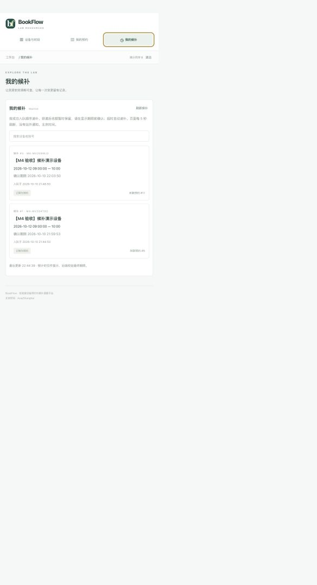

# BookFlow · 实验室设备预约与候补调度平台

围绕“同一设备同一时段只能被有效占用一次”的规则，实现预约、取消、历史记录、管理员维护和可靠候补流程。

**Java 21 · Spring Boot · Spring Security · MyBatis · MySQL · Vue 3 · Vite**

[启动与接口](RUNNING.md) · [业务设计](docs/design.md) · [验证记录](docs/validation.md) · [作品集首页](../README.md)

## 已实现

- 普通用户登录、查询时段、预约、取消和查看本人记录；管理员维护设备和时段。
- MySQL 事务、固定锁顺序与唯一约束共同控制有效占用；后端检查记录归属、时段状态和开始时间。
- 按用户隔离的持久化幂等键，重试同一成功请求返回原响应；取消后重新预约使用新键。
- 满额候补、按入队顺序递补、限时确认、超时释放和服务重启后的任务恢复。
- Session、BCrypt 和 CSRF；演示账号密码由本地环境配置生成。

## 演示截图

截图来自 2026-10-10 的本地演示。首次运行需生成当前日期的演示时段，具体步骤见运行说明。

## 重点代码

| 关注点 | 代码入口 |
| --- | --- |
| 预约事务与校验 | [ReservationService](backend/src/main/java/com/bookflow/reservation/ReservationService.java) |
| 请求幂等 | [IdempotencyService](backend/src/main/java/com/bookflow/idempotency/IdempotencyService.java) |
| 候补与超时处理 | [WaitlistCoordinator](backend/src/main/java/com/bookflow/waitlist/WaitlistCoordinator.java) |
| 真实 MySQL 并发测试 | [ReliabilityMySqlIT](backend/src/test/java/com/bookflow/workflow/ReliabilityMySqlIT.java) |
| 结构迁移 | [Flyway migrations](backend/src/main/resources/db/migration/) |

## 验证与边界

历史验收记录包含 4 项单元测试、44 项真实 MySQL 集成测试，以及 HTTP、重启恢复和浏览器操作检查。本次作品集复核结果见 [VERIFICATION](../docs/VERIFICATION.md)。

当前覆盖 M1—M4。没有支付、短信通知、分布式集群或公网生产部署。数据库锁的并发权衡及会话重启失效等限制在设计文档中说明。
