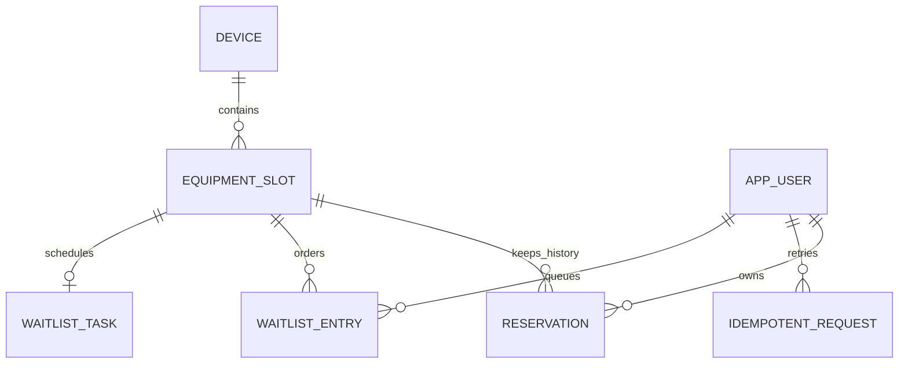
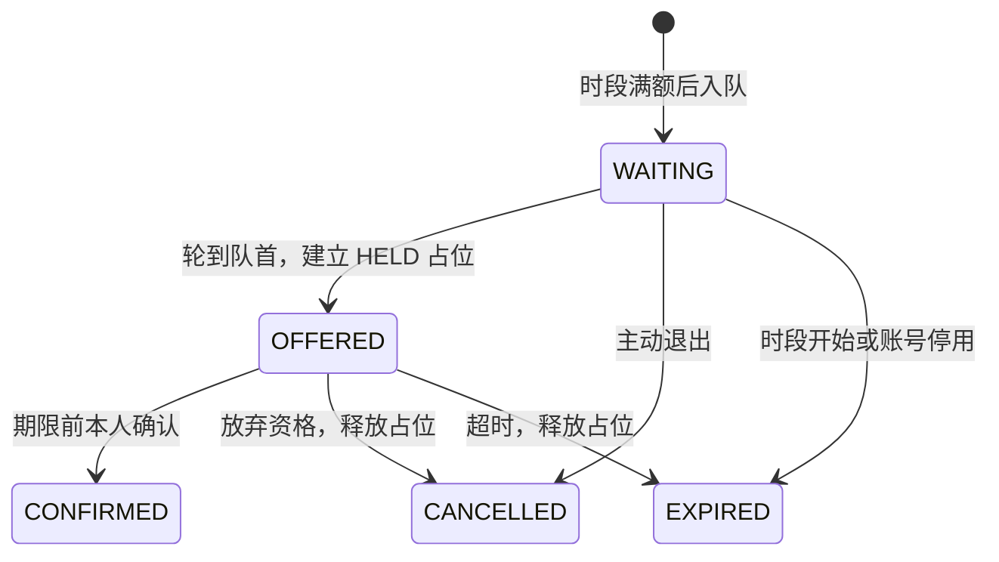

# BookFlow 最终设计说明（M1～M4）

## 表关系与迁移

| 表 | 用途 | 关键约束 |
| --- | --- | --- |
| app_user | 用户名、BCrypt 哈希、角色、启用状态、演示标记 | 唯一用户名、USER/ADMIN CHECK |
| device | 一台具体设备 | 唯一资产编号、ACTIVE/INACTIVE |
| equipment_slot | 设备固定时段 | 外键、结束晚于开始、相同时段唯一 |
| reservation | CONFIRMED / CANCELLED / HELD / EXPIRED | 用户/时段外键、有效预约与限时资格共用唯一占用 |
| idempotent_request | 用户作用域的成功请求与响应 | (user_id, request_key) 主键；操作/资源绑定 |
| waitlist_entry | 排队、获邀、确认、退出/过期历史 | 每用户每时段最多一个活动候补，每时段最多一个 OFFERED |
| waitlist_task | 下一处理期限、状态、连续失败次数 | 每时段一行，PENDING / DONE 与 next_run_at 一致 |

V1 和原 demo SQL 保留；V2 给用户增加演示标记；V3 持久化幂等请求；V4 扩展预约状态、加入候补和任务表。demo profile 下，账号初始化器在事务中创建缺少的演示账号，密码由环境变量提供，BCrypt cost=12；不覆盖已有用户名、密码或角色。未启用 demo 时不自动创建账号，也没有公开注册入口。

## 登录、角色和归属

Spring Security 原生表单登录过滤器读取用户名/密码，由 `DatabaseUserDetailsService` 查询 MySQL，`DaoAuthenticationProvider` 校验启用状态及密码哈希。成功后变更 Session ID 并保存 SecurityContext，返回不含哈希的用户信息。浏览器仅保存 HttpOnly、SameSite=Lax 的 JSESSIONID Cookie；开发环境经 Vite 同源代理访问，不在 localStorage 保存凭据。

默认 CSRF 防护覆盖登录、退出和业务写操作。前端每次写入先访问 `/api/auth/csrf`，把当前 session 的 XOR token 放在响应指定的请求头中。不能只因为接口使用 JSON 就关闭 CSRF。退出使 Session 失效，登录/退出后重新获取 token。

公开目录允许匿名；`/api/admin/**` 限 ADMIN，管理服务也有 `@PreAuthorize`。预约控制器从 `@AuthenticationPrincipal BookFlowUser` 取用户 ID，不接受客户端指定的 userId。查询 SQL 带本人 user_id 条件；取消前核对归属，并在更新 SQL 再带 user_id。ADMIN 可查全部记录，但不能代其他用户取消。隐藏按钮只是体验，后端检查才是权限边界。

## 有效占用、历史和事务

CONFIRMED 和 HELD 的生成列 `active_slot_id = slot_id`；CANCELLED 和 EXPIRED 的生成列为 NULL。唯一索引允许多个 NULL，因此保留任意数量的取消历史，同时最多一条有效占用。取消改变同一行的状态和取消时间，生成列由 MySQL 同步变化；重新预约 INSERT 新行，获得新 ID。HELD 是限时资格，不是有效预约；确认通过 UPDATE 转为 CONFIRMED，超时转 EXPIRED，保留资格历史。

每次写操作由 Service 公共方法上的 `@Transactional(isolation = READ_COMMITTED)` 包住完整校验与写入。锁定顺序统一为 **设备 → 时段 → 预约**。事务提交/回滚前锁不释放，禁止用 JVM 内存锁替代数据库锁。

预约先用一次普通查询定位时段所属设备，再 `SELECT ... FOR UPDATE` 锁设备和时段；锁后读取时钟，校验未来、开放、无占用后 INSERT。设备停用、时段编辑也锁同一设备行，防止“检查通过后管理员关掉设备”的窗口。已有活动候补时，直接预约也不能插队。重复占用除了业务检查还有唯一索引兜底，冲突抛运行时业务异常触发回滚，返回 409。

取消先核对本人，再按统一顺序锁行，重新检查归属、状态、开始时间后 UPDATE。已取消记录直接返回原结果，不重复更新 cancelled_at。未取消但已开始的记录拒绝修改。所有判断使用 Asia/Shanghai Clock，开始瞬间即不能预约/取消。

采用 READ_COMMITTED 是为了避免定位查询在等待锁之前建立的旧一致读快照影响后续状态判断。锁查询带 `useCache=false, flushCache=TRUE`，确保 MyBatis 不从会话一级缓存复用旧锁查询结果，实际访问数据库获取锁和当前状态。真实 MySQL 测试曾暴露同一事务缓存旧设备状态的问题，修复后原断言通过。

**局限：** 设备锁较粗，同设备不同时间的写入也串行化；大量历史列表尚未分页。未做吞吐量或高并发承诺。锁等待/死锁等临时失败返回 503，不在客户端自动重发写请求。多人竞争和幂等已通过真实 MySQL 多线程测试；没有据此推断吞吐量，更细锁粒度仍需另行评估。

## 管理规则

| 操作 | 规则 |
| --- | --- |
| 修改设备 | 编号不可改；名称/说明/位置可修订，历史展示当前资料 |
| 停用设备 | 不能存在 end_at > now 的 CONFIRMED/HELD 或任何活动候补 |
| 删除设备 | 不能有任何关联时段；外键 RESTRICT 兜底 |
| 创建时段 | 未来、结束晚于开始、整分钟、起止年份 1000～9998 |
| 修改时段 | 不可换设备；已开始不可编辑；有任何预约/候补历史不可改时间 |
| 关闭时段 | 不能存在有效占用（CONFIRMED/HELD）；活动队列按事务规则递补，不能绕过资格关闭 |
| 删除时段 | 不能有任何预约/候补历史，包括已取消；无历史的过去时段也允许清理 |
| 排班重叠 | 锁设备后检查 existing.start < new.end AND existing.end > new.start；开放/关闭都参与，相邻允许 |

数据库 `(device_id,start_at,end_at)` 唯一索引只能防完全相同时段，不能防部分重叠，所以还需要事务内重叠查询。外键只阻止删除，不能独立阻止篡改有历史的起止时间。

## 时间、失败与恢复边界

单一实验室时区 Asia/Shanghai。MySQL DATETIME(6) 保存本地时间，连接 session 设置 +08:00，Java Clock 同区；前端按时间字符串显示，不交给浏览器随意转换时区。未来跨时区需要另行迁移设计。

目录读取使用只读事务和数据库一致快照；查询状态只代表当次读取，提交时重新校验。readOnly 不是鉴权，不会预占资源。开始/结束边界优先于开放/占用状态，避免过期时段误显示可预约。

400 非法输入、401 未登录/登录失败、403 CSRF/角色/归属失败、404 不存在、409 业务或完整性冲突、503 数据库暂不可用。响应不暴露 SQL/堆栈。页面提供加载、空结果、错误及操作结果；写入进行时禁用重复按钮，网络失败提示先查记录，不自动重放。

登录 Session 暂在单体进程内存中，重启需重登；数据库事务及已提交预约/历史持久化。账号角色/启用状态在登录时读取，本阶段没有账号管理/实时撤权端点，直接在数据库改角色后应退出重登。HTTPS、安全 Cookie、生产凭据/迁移账号、会话持久化属于后续部署设计。

## 请求幂等：成功响应与业务一起提交

`IdempotencyService.execute` 是预约、加入候补和确认资格的最外层 READ_COMMITTED 事务。先通过 `(user_id, request_key)` 唯一主键 INSERT ... ON DUPLICATE KEY UPDATE 获取请求行锁；并发同键会等待先行事务完成。再检查 operation/resource_id 绑定，已有成功响应则原样返回，否则执行服务逻辑并保存状态码和 JSON 后一起提交。

锁顺序为请求行（如有）→设备→时段→预约/候补；不会在持有设备锁后再申请请求键。失败事务整体回滚，不留下“处理中”的半成品；数据库重启会回滚未提交事务。只持久化成功结果，业务拒绝和临时失败不缓存。序列化失败也回滚业务写入。相同键换操作/资源 409，不同用户可以使用相同字符串。

取消后重约使用新键。旧键一直表示旧请求，所以重放可能仍显示当时的 CONFIRMED，即使记录现在 CANCELLED；GET 查询才表示当前状态。响应头 Idempotency-Replayed 标记重放。前端按用户/操作/资源在 sessionStorage 保留未确定请求的键，HTTP 明确成功/拒绝后清除，网络/5xx 时保留。取消已知预约后清理对应旧意图。跨浏览器/清空存储不会保留客户端键，但后端成功记录仍存在。

没有自动清理成功键，空间会持续增长；设计清理策略时必须同时定义“过期键能否当新请求”的协议，不能只定期 DELETE。取消和退出针对已有记录做条件状态变更，重复调用返回原结果，不另建资源。

## 候补状态机与容量

顺序按设备锁内插入的 ID 升序，而非客户端时间。成功加入才算排队；并发请求的锁获得顺序决定入队顺序。相同用户每时段最多一个 WAITING/OFFERED，持有有效预约/资格的人不能再加入。退出后可重新入队，但属于新记录并排到队尾。

取消预约、释放唯一占用、选择下一人、创建 HELD 预约行、设置 OFFERED 和期限、登记任务，全部在同一个事务完成。不会出现先提交取消再用内存消息递补的间隙。HELD 与 CONFIRMED 共用唯一索引，直接 SQL 尝试在 HELD 期间插入正式预约也会被数据库拒绝。

确认期限为 min(发出资格时 now + 配置秒数, 时段开始时间)，默认 900 秒。确认和超时处理都先锁设备/时段，再读取当前状态和时钟；now < expires_at 才可确认。达到边界时只允许过期。确认 UPDATE 原 HELD 行，没有释放再插入的空窗。已转为预约的候补保留 CONFIRMED 历史，后续预约取消通过预约表展示。

## 持久化任务与重启恢复

`waitlist_task` 每时段一行，next_run_at 指向当前资格期限；已有预约且队列仍等待时指向时段开始，用于结束未完成队列。没有活动候补时写 DONE，保留任务记录。资格、期限和任务始终同事务更新。

`WaitlistWorker` 默认每 5 秒查询最多 100 个到期 PENDING 任务，对每个调用独立事务 `processDue`。扫描结果不是执行许可：拿到设备/时段锁后重读任务，已经完成或延期就跳过。两个扫描器/重复执行因此不会发出两个资格，也不需要依赖单进程互斥锁。测试实际验证两个工作线程同时处理同一超时。

异常使业务事务回滚；工作器尝试记录失败类型和 10 秒后的重试时间，不写 SQL 详情/凭据。记录失败本身也失败（例如数据库离线）时，原到期任务仍留在库里，后续扫描可再次发现。条件更新避免覆盖其他执行者已改成未来期限或 DONE 的任务。成功处理清零连续失败次数。

重启扫描不依赖以前的内存定时器，已过期任务即使错过时间也可继续。独立 `_test` 库的真实 Java 进程 SIGKILL/重启验收已证明已提交资格、超时递补及幂等响应跨进程存活；进程内事务异常注入另验证取消/递补和超时/递补整体回滚。

**实际边界：** 这是一套周期扫描，健康服务通常在扫描周期附近处理，不是硬实时保证；停机期间不通知、不递补，恢复后继续。全部用户看到的是站内轮询，无短信/邮件。多实例正确性依靠 MySQL，但应用时钟应同步；未做跨主机部署/时钟偏差实验。没有生产负载或断电损坏恢复承诺。

## 为什么现在不用 Redis 或消息队列

数据库已经承担容量、顺序和期限的事实来源，当前小规模单体用一套事务容易解释和验证。新增缓存/队列不会替代原有数据库一致性规则，还会引入双写和消息重放。未来只有在实际扫描负载、通知延迟或横向部署需求出现时再评估；已有索引分别支持有效占用、队列顺序和到期任务查询。
