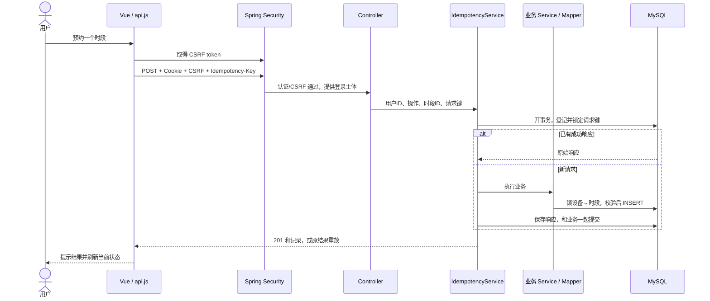

# BookFlow 完成后的学习路线

项目已实现原计划 M1～M4。建议先演示成功流程，再读代码，最后解释并发和失败。不要一开始同时阅读所有类。

## 先演示一个完整故事

1. 启动 MySQL、后端、前端，用 student 登录，选择未来的开放时段并预约。
2. 换 student2 登录同一时段，加入候补；管理员账号也可以本人身份排在后面。
3. student 取消，student2 的“我的候补”出现确认期限和倒计时；确认后“我的预约”出现有效预约。
4. 再演示放弃资格/确认超时，管理员“候补与任务”可见状态变化。
5. 执行 `node scripts/smoke-recovery.mjs`，用独立测试库演示真实后端崩溃/重启恢复，不干扰 8080 服务。

默认期限 15 分钟；短演示可按 README 改为 30 秒后重启，只影响以后新发出的资格。演示时说明账号/设备均为测试数据，不展示 .env 密码，不声称实际生产使用人数或性能。

## 主要文件导读

| 阅读顺序 | 文件 / 职责 |
| --- | --- |
| 1 | `frontend/src/App.vue`：页面、当前用户、登录过期后的反馈 |
| 2 | `frontend/src/api.js`：真实 fetch、CSRF、请求键保留和结果不确定时的重试 |
| 3 | `config/SecurityConfig.java`、`auth/*`：认证、密码哈希、Session、角色限制 |
| 4 | `reservation/ReservationController.java`：从登录主体取 userId，不信任客户端身份 |
| 5 | `idempotency/IdempotencyService.java`：最外层事务、同键串行、响应持久化 |
| 6 | `reservation/ReservationService.java`、`ReservationMapper.java`：预约/取消、时间和归属、SQL |
| 7 | `waitlist/WaitlistService.java`：加入、确认、退出、到期处理的事务入口 |
| 8 | `waitlist/WaitlistCoordinator.java`：容量释放与递补状态机，必须加入已有事务 |
| 9 | `waitlist/WaitlistWorker.java`：定期扫描，不把内存当作任务事实来源 |
| 10 | `db/migration/V1～V4`：表关系、生成列唯一约束、候补/请求/任务持久化 |
| 11 | `workflow/ReliabilityMySqlIT.java`：独立线程/数据库连接上的真实竞争与回滚断言 |

Java 路径均相对 `backend/src/main/java/com/bookflow/`，迁移在 `backend/src/main/resources/`，测试在 `backend/src/test/java/com/bookflow/`。M1/M2 的逐步材料保留在 `m1-learning.md`、`m2-learning.md`。

## 一次请求从网页走到数据库

Controller 负责 HTTP 输入和登录身份；Service 负责业务与事务；Mapper 负责参数绑定 SQL；数据库负责持久化和约束。前端的“开放”只是一张快照，提交时后端必须重查。

取消的路径不创建新幂等请求，而是对本人记录做状态变更；同一事务调用 Coordinator，释放旧占位并发出下一份资格。Worker 从另一个 Bean 调用 `processDue`，Spring 事务代理才会参与，不能把它改成类内部自调用后假定注解仍生效。

## 六个必须能解释的知识点

1. **Java 基础：** record 适合不可变的数据传输结构；构造器注入表达类依赖；异常向外传播既决定 HTTP 错误，也决定事务是否回滚。Supplier/lambda 在这里仅用于把一段业务交给幂等事务执行，不是后台线程。
2. **身份与权限：** Spring Security 验证密码哈希并建立 Session；角色决定能否进入管理员接口，记录的 user_id 决定能否取消。CSRF 防止浏览器自动带 Cookie 被滥用，与角色/归属是不同检查。
3. **事务与锁：** `@Transactional` 定义“哪些操作共同提交”；READ_COMMITTED 是隔离设置，FOR UPDATE 是实际行锁；按一致顺序拿锁降低死锁风险。MyBatis 锁查询显式清缓存，不能读到之前缓存的锁结果。
4. **数据库约束：** active_slot_id 在 CONFIRMED/HELD 时等于时段 ID，其他状态是 NULL。唯一索引允许多个 NULL，所以既保留历史，也防止两种有效占位重叠。
5. **请求幂等：** 相同键是重试一次操作，新键是新意图。成功响应与业务同事务存储；重放旧响应不等于查询最新状态。网络断开并不能证明服务端失败。
6. **失败恢复：** 定时扫描只是触发器，资格/期限/任务状态在 MySQL。确认和超时锁同一资源、检查同一状态，所以不会两个都成功；重启重新扫描已到期任务。扫描周期会带来延迟，没有硬实时保证。

## 一个手动修改练习

在“我的候补”顶部新增“排队 N 人次 / 待确认 M 人次”两个计数，用 `computed` 从当前页面的 `rows` 推导 WAITING/OFFERED 数量。不要维护额外可变计数，也不要修改后端排队顺序。

验收：加入、确认、退出、超时自动刷新后数字与列表一致；换账号不显示上一位的数据。完成后回答：为什么这个前端计数不能代替数据库中的容量判断？

## 三个与当前代码有关的面试问题

1. 两个 Java 进程同时预约同一时段时，`synchronized` 为什么不够？本项目的设备锁、生成列唯一索引和幂等请求表分别解决什么问题？
2. 请求已经提交，但响应在网络中丢失；用户重试时怎么避免重复插入？如果用户先取消再重新预约，为什么必须换键？
3. 用户点击确认的同时超时扫描开始，两条执行路径如何保证只成功一条？如果服务在取消后、递补过程中崩溃，哪些数据会提交或回滚，重启后如何继续？

先沿代码口头回答，再在 `ReliabilityMySqlIT` 中找相应断言。可以描述已经测过的场景，不能把一次 10 用户竞争测试当作吞吐量测试或生产经历。
