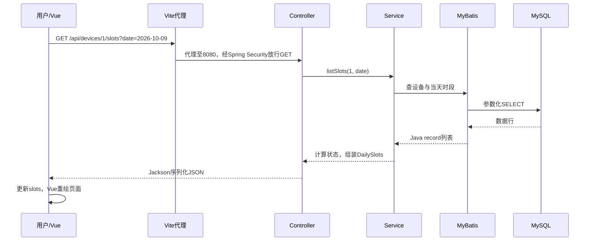

# M1：读懂自己的项目

## 先读这些文件

1. `backend/src/main/resources/db/migration/V1__create_core_tables.sql`：四张表、主键、外键、CHECK 和唯一约束。
2. `backend/src/main/java/com/bookflow/catalog/CatalogController.java`：URL 如何映射成 Java 方法，路径与日期参数从哪里来。
3. `CatalogService.java`：业务状态、时间边界、设备不存在时的行为；构造器注入 Mapper 和 Clock。
4. `CatalogMapper.java`：把参数绑定到 SQL，并把每一行映射为 Java record；这里是真实数据库访问。
5. `Device.java` / `SlotRow.java` / `SlotView.java` / `DailySlots.java`：数据库查询结构与返回给浏览器的数据结构。
6. `frontend/src/App.vue` / `api.js`：Vue 的响应式状态、fetch、列表渲染、加载/失败/空状态以及防止旧请求覆盖。
7. `application.yml` / `SecurityConfig.java`：环境配置与本阶段公开接口的边界。
8. `CatalogServiceTest.java` / `CatalogMySqlIT.java`：单元测试与真实数据库集成测试分别负责什么。

## 一次点击如何流转

Vite 不是数据库，浏览器也不拿数据库密码。浏览器通过 HTTP 调用后端，后端通过 JDBC 连接池使用 MyBatis 执行 SQL。JSON 是跨语言交换的数据格式，Java 对象与 JavaScript 对象是两端分别创建的。

## 本阶段必须理解

- **类、接口与 record**：Controller/Service 是带行为的类；Mapper 是由 MyBatis 创建实现的接口；record 简洁表达一条数据，不等于数据库表本身。
- **构造器注入**：Spring 创建对象并传入依赖。自己不在 Controller 里 `new CatalogService(...)`，测试时可以替换 Mapper 和 Clock。
- **HTTP 与状态码**：200 空数组表示请求成功但没有数据；404 表示设备不存在；503 表示依赖数据库故障。它们不可混成一种状态。
- **关系与约束**：主键标识记录，外键保持关系，唯一索引让数据库拒绝非法重复。Java 的 if 判断不能替代数据库约束。
- **参数绑定**：`#{deviceId}` 是绑定参数；不是把输入直接拼到 SQL 字符串。SQL 的 WHERE 在数据库执行，前端关键词搜索目前在浏览器执行。
- **事务基础**：一次只读事务包含两次查询，使用同一快照。它不能给未来的写入“预留名额”；预约事务会在 M2 专门设计。
- **状态快照**：网页看到“开放”只表示查询瞬间状态，不保证下一秒仍开放。后端写入必须再次检查。
- **版本与迁移**：Wrapper 固定构建工具，BOM 固定一组兼容依赖，npm lock 固定依赖树，Flyway 固定数据库结构变化顺序。
- **测试边界**：Mock 单元测试能验证 Java 逻辑；只有真实 MySQL 才能验证这里的生成列、唯一索引、外键和 SQL 映射。M1 还没有并发锁测试。

## 一个小练习

给设备增加一个**展示字段 `usageNote`（使用提示）**，先只作为后端由已有 `status` 推导的响应字段，不改数据库：ACTIVE 返回“使用前请完成设备培训”，INACTIVE 返回“设备维护中”。

建议步骤：先新增 `DeviceView` 返回 record，在 Service 映射 Device → DeviceView，再修改 Controller 返回类型，在设备详情展示 `usageNote`。给映射添加一个有意义的测试，验证 ACTIVE/INACTIVE 两种值。完成后用浏览器和 curl 比较 JSON，解释为什么本练习不需要数据库迁移。不要把这两个文字只写在前端，否则练不到完整接口链路。

## 三个与当前代码有关的面试问题

1. 为什么同一时段的有效预约用 `active_slot_id` 生成列＋唯一索引，而不是 `UNIQUE(slot_id,status)`？取消两次后会有什么区别？
2. 浏览器点击设备后，Controller、Service、Mapper、MySQL 各负责什么？MyBatis 的 `#{deviceId}` 为什么比字符串拼接安全？
3. 查询时段为什么使用 `[当天零点, 次日零点)`？`@Transactional(readOnly=true)` 能保证下一次预约一定成功吗？哪些错误需要用真实 MySQL 才能发现？

答题时引用你实际看过的代码和测试结果，不要宣称已实现 M2/M3/M4 或有生产运行经历。
