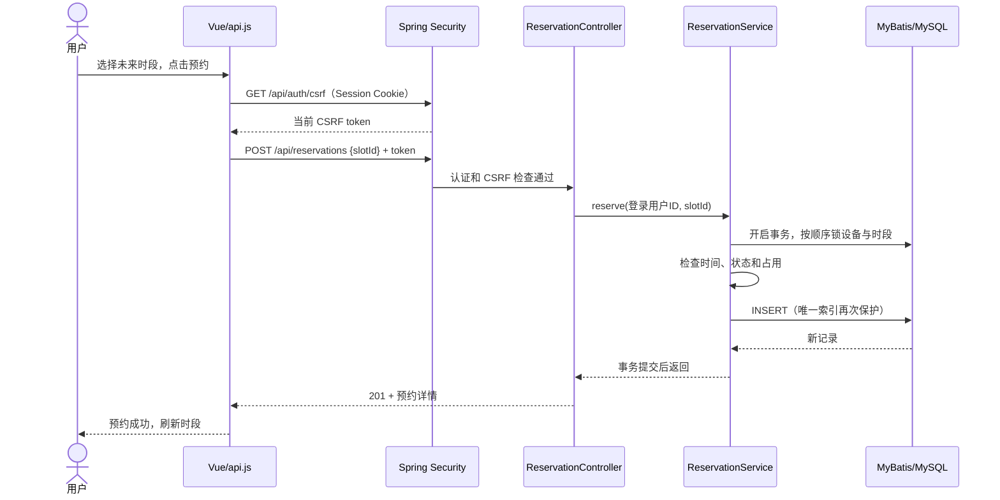

# M2 学习与演示指南

先运行 README 的三个服务，以 student 登录。选择未来日期预约，再去“我的预约”取消，再预约同一时段：旧记录 CANCELLED，新记录拥有不同 ID。使用 student2 可以演示占用冲突；admin 可以查看全部记录和维护设备/时段。

## 建议按这个顺序读代码

| 文件（相对仓库根目录） | 重点 |
| --- | --- |
| frontend/src/components/CatalogPage.vue | 点击预约，提交 slotId，显示结果并刷新时段 |
| frontend/src/api.js | fetch、Cookie、CSRF、状态码、失败不自动重发 |
| backend/src/main/java/com/bookflow/config/SecurityConfig.java | 登录过滤器、认证失败、角色检查、Session 和 CSRF |
| backend/src/main/java/com/bookflow/auth/DatabaseUserDetailsService.java | 按用户名读 MySQL；认证框架校验密码 |
| backend/src/main/java/com/bookflow/reservation/ReservationController.java | 从已登录主体提取 userId，把输入交给 Service |
| backend/src/main/java/com/bookflow/reservation/ReservationService.java | 事务边界、时间/归属校验、加锁、写入 |
| backend/src/main/java/com/bookflow/reservation/ReservationMapper.java | 参数绑定 SQL、本人过滤、INSERT 与条件 UPDATE |
| backend/src/main/java/com/bookflow/catalog/CatalogMapper.java | FOR UPDATE，MyBatis 缓存与数据库当前状态 |
| backend/src/main/resources/db/migration/V1__create_core_tables.sql | 外键、CHECK、生成列唯一约束 |
| backend/src/main/java/com/bookflow/admin/AdminService.java | 为什么管理写入也要锁设备、保护历史 |
| backend/src/test/java/com/bookflow/workflow/BookingWorkflowMySqlIT.java | 真实登录和 MySQL 事务中的正常与失败路径 |

## 一次预约请求怎样流转

登录与预约是不同请求。登录证明“你是谁”，Session 让后续请求沿用身份；预约事务只覆盖这次数据库校验与写入，不会一直持有到用户点击取消。

## 你必须理解的五点

1. **认证、角色、归属不同。** 登录成功不意味着能取消任何记录；USER/ADMIN 是粗粒度角色，reservation.user_id 是具体数据归属。客户端提供 userId 不能作为证据。
2. **哈希不是加密。** BCrypt 使用随机盐并增加计算成本，登录时 matches 验证，无法解密取回原密码。数据库和接口都不应保存/返回明文；演示明文仅在被忽略的本机配置供学习使用。
3. **事务保证一组操作一起成功或失败。** Spring 通过代理启动事务，运行时异常向外抛出触发回滚；不要吞掉插入失败后继续提交。`@Transactional` 不是“自动解决所有竞争”。
4. **行锁和约束各有责任。** 锁把校验与写入串起来，也协调管理员修改；唯一索引给“最多一个有效预约”最终保护。设备锁简单但牺牲同设备写入并行度。M3 才通过并发测试证明更复杂交错。
5. **取消是状态变更。** 不 DELETE，生成列变 NULL 释放占用。重新预约 INSERT 新记录；相同请求重发属于幂等问题，M2 只拒绝重复占用，还不能重放第一次成功响应。

CSRF 是额外要理解的一点：浏览器自动携带 Cookie，因此后端还需校验写请求的安全凭证。前端不保存 Cookie 内部值，只经框架的 token 端点取得 CSRF token；角色权限和 CSRF 防护不能互相替代。

## VS Code 调试练习

在 `ReservationController.reserve`、`ReservationService.reserve` 的锁后校验、`ReservationMapper.insert` 附近打断点。用 README 的 F5 配置或 5005 附加调试；先关闭已运行的普通后端，避免端口冲突。

观察 userId 如何从登录对象传入，slotId 如何来自 JSON；再比较普通定位查询与 FOR UPDATE。暂停事务会占有锁，另一个请求可能等待，这是数据库行为，不要把调试停顿当性能结果。

## 一个小的手动修改练习

给“我的预约”顶部增加“有效 N 条 / 已取消 M 条”计数。只根据该页面后端返回的 `rows` 和每条 `reservation.status` 用 Vue `computed` 推导，不另外维护可变计数。预约、取消后刷新，确认两个数字与列表一致；切换账号不能显示上一位用户的数据。

完成后解释：为什么前端计数可以帮助展示，却不能用于决定数据库是否允许预约？相关文件是 `frontend/src/components/ReservationList.vue`。

## 三个面试问题

1. 如果只做“SELECT 没有预约，再 INSERT”，两名用户同时预约会怎样？本项目的设备行锁和 `active_slot_id` 唯一索引分别解决什么？
2. 为什么取消预约用 UPDATE 而不是 DELETE？取消后重约为什么能保留两条记录，却只有一条占用？
3. 如果用户把取消 URL 的 ID 换成别人的预约，后端哪几层会处理？为什么隐藏按钮、检查 USER 角色、CSRF 校验都不能替代归属检查？

建议先不看答案，沿对应文件解释每一步；可在数据库测试中找到可运行例子。不要在简历里把 M2 顺序验证表述为已完成高并发、可靠候补或生产运行。
