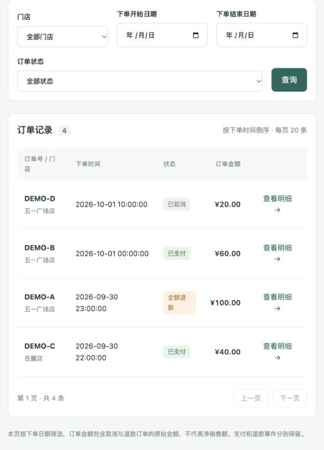

# 门店订单与经营报表后台

把模拟门店 CSV 订单导入数据库，并按支付、退款发生日期生成可核对、可下钻、可导出的经营报表。

**Java 21 · Spring Boot · Spring Security · MyBatis · MySQL · Vue 3 · ECharts**

[启动与演示](RUNNING.md) · [接口说明](docs/api.md) · [SQL 分析](docs/performance.md) · [作品集首页](../README.md)

## 已实现

- CSV 格式与业务预检查、整批事务提交、文件哈希和订单唯一约束去重；失败时保留独立错误记录。
- 管理员与门店用户权限；查询、统计、详情、导入和导出均在服务端校验门店范围。
- 金额以整数分保存，按支付/退款事件日期统计，支持总览、趋势、门店与商品维度。
- 从报表下钻到资金事件及原始订单；CSV 导出使用同一筛选口径，记录本人导出历史。
- 通过实际 MyBatis 查询的 EXPLAIN 与 EXPLAIN ANALYZE，分析并补充门店、状态和时间组合索引。

## 演示截图

这是已有 M1 台账截图。M2/M3 报表的浏览器点击与下载落盘验收仍待补，不以这张截图代替。

## 重点代码

| 关注点 | 代码入口 |
| --- | --- |
| CSV 校验 | [CsvValidator](backend/src/main/java/com/orderreporting/CsvValidator.java) |
| 导入事务 | [ImportWriter](backend/src/main/java/com/orderreporting/ImportWriter.java) |
| 事件口径统计 | [ReportMapper](backend/src/main/java/com/orderreporting/ReportMapper.java) |
| 导出与审计 | [ExportService](backend/src/main/java/com/orderreporting/ExportService.java) |
| 组合索引迁移 | [V3 migration](backend/src/main/resources/db/migration/V3__store_status_order_paging.sql) |

## 验证与边界

历史完整回归为 4 项单元测试和 31 项真实 MySQL 集成测试。另有本机 50,000 单、100,000 明细的独立查询分析，原始口径与样本见性能报告；这些数字是模拟测试规模。

本次整理复核见 [VERIFICATION](../docs/VERIFICATION.md)。不包含真实支付、部分退款、已有订单覆盖、生产部署或负载容量承诺。CSV 同步小文件导入和深分页等限制保留在运行说明中。
