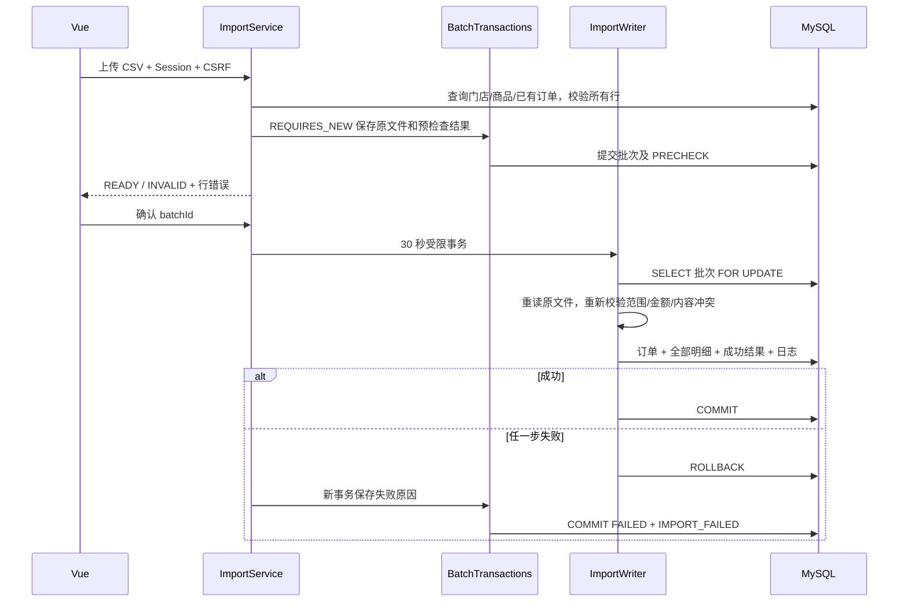

# 模型与统计口径（M1—M3）

所有日期按 Asia/Shanghai。MySQL DATETIME 保存上海当地时间，无隐式 UTC 日期切换；CSV 精确到秒。列表的 `from/to` 是**下单日期**；经营报表按支付/退款事件日期，不复用列表的下单时间过滤。

## 先用四笔订单约定口径

演示文件 4 笔订单、5 条明细；数据可直接手算。

| 订单 | 门店 | 原始金额 | 支付事件 | 退款事件 | 当前快照状态 |
|---|---|---:|---|---|---|
| A | CS01 | 100（60+40 两行）| 9/30 23:59:59 | 10/1 00:00:00 | REFUNDED |
| B | CS01 | 60 | 10/1 00:00:00 | 无 | PAID |
| C | CS02 | 40 | 9/30 23:59:59 | 无 | PAID |
| D | CS01 | 20 | 无 | 无 | CANCELLED |

| 日期 | 门店 | 销售额 | 退款额 | 净销售额 |
|---|---|---:|---:|---:|
| 9/30 | CS01 | 100 | 0 | 100 |
| 9/30 | CS02 | 40 | 0 | 40 |
| 9/30 | 合计 | 140 | 0 | 140 |
| 10/1 | CS01 | 60 | 100 | -40 |
| 10/1 | CS02 | 0 | 0 | 0 |
| 10/1 | 合计 | 60 | 100 | -40 |

销售额：区间内支付事件的原单金额，包含已经全额退款的订单。退款额：区间内退款事件的原单金额，显示正值；净销售额＝销售额−退款额，可以为负。取消订单不产生资金事件。支付笔数和退款笔数按事件分别计数，不通过当前状态过滤历史支付。全额退款数量等于原订单全部明细数量。

禁止 `WHERE status='PAID'` 计算历史销售，否则 A 的原支付记录会被漏掉。禁止把退款一律回记支付日。M1 验证原始事件保留；M2 将同一事件口径用于统计、ECharts、下钻和资金明细 CSV，并用真实 MySQL 对账。

商品口径也能手算：9/30 TEA 销售 2 件/60 元，CAKE 销售 2 件/80 元；10/1 TEA 销售 2 件/60 元、退款 2 件/60 元，CAKE 退款 1 件/40 元。M2 使用明细金额汇总商品，不把整单 100 元在每条明细上累加。

## 表与约束

- `stores`、`products`：代码唯一；商品主数据全店共享。
- `users`：ADMIN 无门店，STORE 必须绑定一个门店；角色及范围始终从数据库认证账号读取。
- `import_batches`：保存原 CSV、文件哈希、发起人、预检查结果、最终数量和错误；唯一键 `(owner_id,file_hash)`。
- `orders`：门店＋外部订单号唯一，保存三个事件时间、状态、原金额、完整内容哈希、首入批次。
- `order_items`：订单＋明细号唯一，商品外键，整数分金额；约束 `line_cents=quantity*unit_cents`。
- `audit_log`：预检查、成功、失败的发起人/批次/时间/结果，不存密码。

数据库 CHECK 约束保护状态/时间、金额和数量；跨行合计与同单字段一致性由确认事务重新校验。订单和明细无编辑、删除接口；商品名是当前主数据名，历史价格保存在订单明细。权限收窄到“批次仅发起账号查看/确认”，管理员跨店权限适用于订单与上传内容，不能代其他账号确认其批次。

## 导入事务

批次行锁串行化同批次并发确认。不同文件同时争用同一订单时，唯一约束让第二个冲突事务回滚，返回可重试错误；重试能确认相同内容并跳过，绝不覆盖不同内容。失败记录使用不同 Spring bean，避免自调用导致 `REQUIRES_NEW` 失效；成功状态不会被另一个请求的失败记录覆盖。

原有 `(store_id,ordered_at,id)` 与 `(ordered_at,id)` 服务列表；M3 经实际查询计划和测量新增 `(store_id,status,ordered_at,id)`，原索引保留。证据与局限见 performance.md，不把索引存在当成所有查询都优化的证明。

## M2 事件视图与查询一致性

Flyway V2 建立 `order_events` 逻辑视图：支付时间非空的订单产生 PAYMENT，退款时间非空的订单产生 REFUND，用 UNION ALL 合并。已退款订单有两种事件，取消订单没有事件。视图不缓存结果，也不是定时汇总表。

总额、按日和门店统计只累加视图的整单金额，不 JOIN order_items。商品统计和下钻才 JOIN 明细，并仅使用 line_cents；商品售出/退回数量分别累加 quantity。报表和导出复用 ReportService 的权限/日期校验、ReportMapper 的事件筛选与明细 SQL。每个 overview、lines、export 方法均使用只读 REPEATABLE READ、30 秒事务，保证同一请求的多个 SQL 来自同一快照。订单与批次原有不可变约定不变。

前端只在查询成功后保存已应用筛选；改表单但未点查询时，仍按已显示的数据范围下钻/导出。点击日/门店/商品图形或表格按钮，传范围和维度到服务端再次鉴权，再由 orderId 打开原始订单。导出读取同一筛选的全部行（不是当前页）；超过限制直接报错。

`export_log` 独立记录 actor、类型、服务端解析后的筛选、行数、时间，只允许本人查看。没有引入报表缓存、异步任务或额外数据库。M3 实测针对订单台账状态筛选并增加联合索引；未实测事件视图的优化效果，也没有添加事件日期索引。
